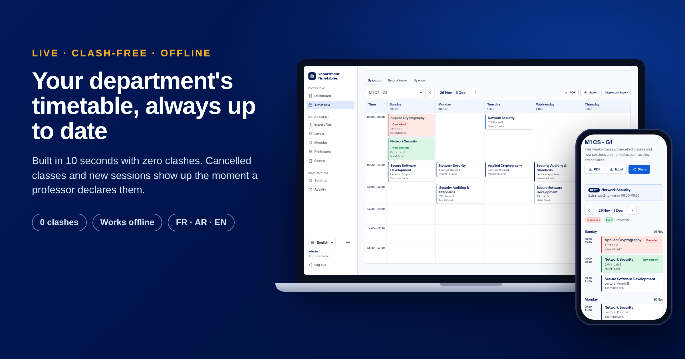
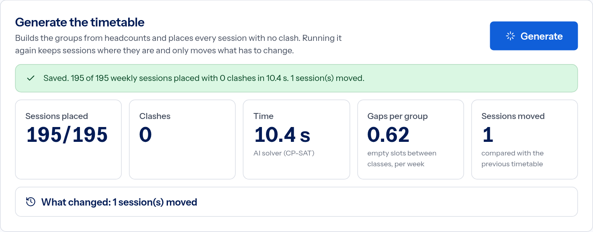
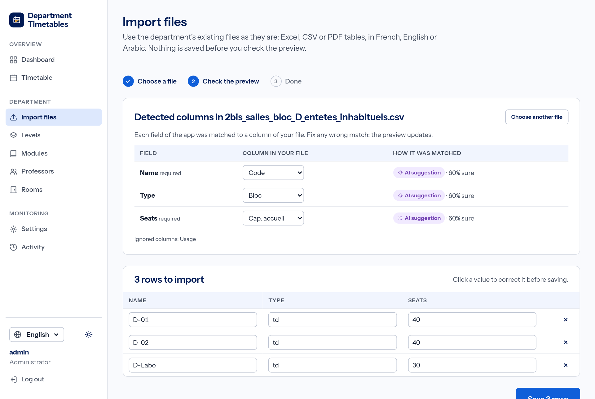
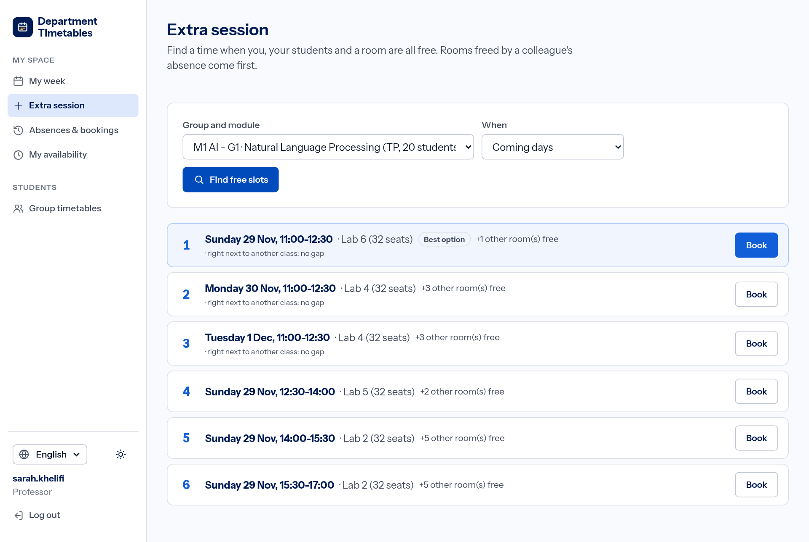
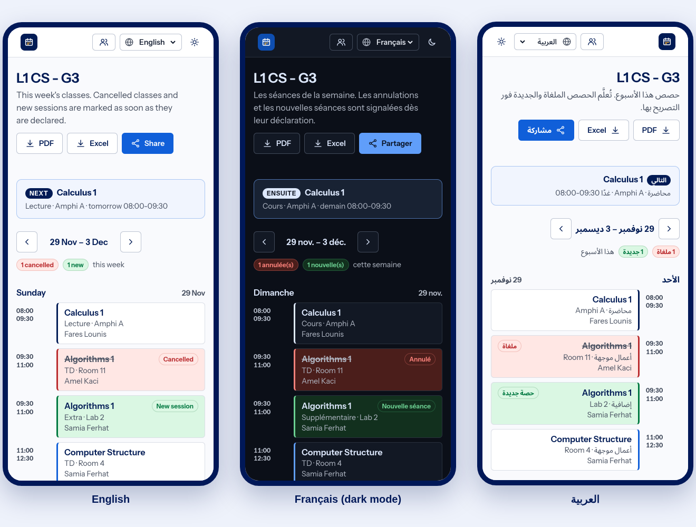
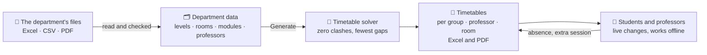

<p align="center">
  
</p>

<h1 align="center">Smart timetables for the department</h1>

<p align="center">
  The weekly timetable of a university department, built in ten seconds with <b>zero clashes</b>,<br>
  and kept up to date live when a room closes or a professor is absent.<br><br>
  <b><a href="https://uniplan.elkamel.dev">▶ Try the live demo: uniplan.elkamel.dev</a></b>
  &nbsp;·&nbsp; Français · العربية · English &nbsp;·&nbsp; works on any phone, even offline
</p>

---

## The problem

In our computer-science department the timetable is still built **by hand in Excel**.

- 🕐 It takes **days**, and **clashes slip through**: two groups in one room, a professor in two places at once.
- 🔁 It breaks **every time something changes**: a room closes for repairs, a professor can't come on Sundays any more.
- 🚪 When a professor is absent, the room **stays empty** while a colleague looks for one to catch up, and students learn about the cancelled class **at the door**.
- 📶 And the connection on campus is often weak.

## What the app does

### For the department's administration

Upload the files you already have (Excel, CSV or PDF lists of levels, rooms, modules and
professors' wish lists), check the preview, and click **Generate**. About ten seconds later
every class has a time, a room and a professor, with **no clash**. When something changes, click
again: **only what has to move moves**, and the app lists what changed and why.

<p align="center"></p>

When the files use unusual column names ("Cap. accueil" for the number of seats), a small AI
on the server suggests the match. Nothing is saved until the administrator confirms.

<p align="center"></p>

### For professors

See your week, tap a class and say **"I'll be absent"**: the students are told and the room is
freed at once. Need a make-up class? The app proposes the **best times** when you, your students
and a room are all free, starting with rooms freed by a colleague's absence. First to book wins.
Professors also mark the slots they **can't** teach, or would **rather not**.

<p align="center"></p>

### For students: no account needed

Open your group's page (a link or a QR code) and see this week's classes, with **Cancelled** and
**New session** labels the moment a professor declares them, and what's **next** today. The last
timetable opened stays readable **without a connection**, and the app can be installed on the
phone. In French, Arabic or English, light or dark.

<p align="center"></p>

## How it works



**Two pieces of AI, both running on the server itself (no internet, no graphics card):**

1. **A timetable solver** (Google OR-Tools, the kind of tool used to plan airline crews). Some
   rules can never be broken: nobody in two places at once, a room big enough and of the right
   kind, a professor only teaches their own modules and never in a slot they can't do, within
   their weekly and daily limits. Within those rules it looks for the best timetable: few empty
   gaps in a student's day, a break after 3 classes in a row, each professor's first choices, and
   as few changes as possible when something moves. *Why not a chatbot?* A chatbot can't promise
   zero clashes for hundreds of students; a solver can, and every timetable is checked again
   before it's saved.
2. **A small language model** (Qwen2.5, 1.1 GB) that reads messy column names in the
   department's files and suggests what each one means.

## What we measured

On an ordinary laptop (AMD Ryzen 7, 16 GB of memory, no graphics card), with an invented
department of **8 levels, 29 groups, 22 professors, 21 rooms and 195 classes a week**:

| | Simple method (for comparison) | **Our AI solver** |
| --- | --- | --- |
| Classes placed | 195 of 195 | **195 of 195** |
| Clashes | 0 | **0** |
| Empty gaps in a student's day (per group, per week) | 0.48 | **0.33** |
| Classes after 3 in a row with no break | 13 | **9** |
| Days when students come in for a single class | 9 | **1** |
| When a busy room closes | its classes move, almost nothing else | **its classes move, almost nothing else** |
| Time to build the timetable | instant | **10 seconds** |

- **Messy files:** out of 40 columns with unusual names, the built-in dictionary recognises
  68 %; with the language model, **88 %**. The rest is fixed by the administrator in the preview.
- **Light:** the server needs about **0.5 GB** of memory while building a timetable, and 1.9 GB
  while the language model reads a file. It runs on any recent laptop or small server.
- **Reliable:** 50 automated tests check every rule, including the three demo cases.

## Limits

- An extra session lasts one time slot (no double-length bookings).
- The solver stops after 10 seconds: the timetable is always valid, but not proven to be the
  best one possible.
- A practical class needs a lab at least as large as the group.
- Photos of paper documents can't be read; PDFs exported from Word or Excel can.
- The demo uses **invented data only**: no real names, no personal data.

## Try it

- **Online:** open **[uniplan.elkamel.dev](https://uniplan.elkamel.dev)**. Students need nothing;
  the administrator and professor logins are given with our submission.
- **Three things to try:** close a room and click Generate · mark a professor "can't" on Sunday
  and Generate · as a professor, declare an absence, then book the freed room as another one and
  watch the student page.
- **On your own computer** (Python 3.11+ and Node 20+):

  ```bash
  cd backend && python -m venv .venv && source .venv/bin/activate && pip install -r requirements.txt
  cp .env.example .env    # set ADMIN_USERNAME, ADMIN_PASSWORD and DEMO_MODE=1
  uvicorn app.main:app    # then, in another terminal:
  cd frontend && npm install && cp .env.example .env && npm run dev
  ```

  Open http://localhost:5173, log in as the administrator, click **Load demo department**, then
  **Generate**.

<sub>For technical readers: [how the AI works](docs/AI.md) · [hosting](docs/DEPLOY.md) · [test checklist](docs/TEST_CASES.md) · [backend](backend/README.md) · [web app](frontend/README.md)</sub>
